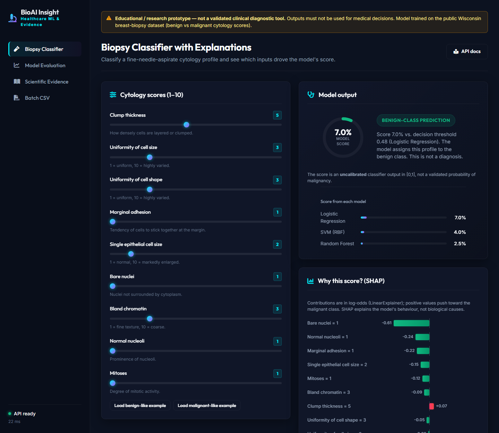
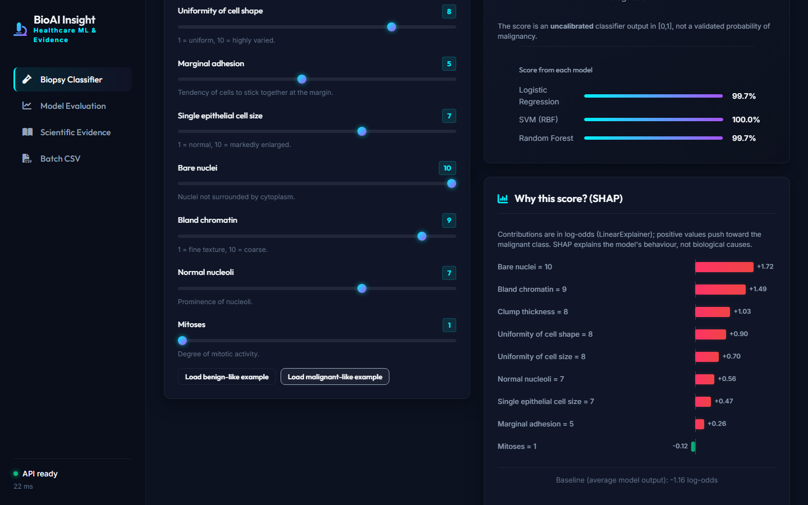
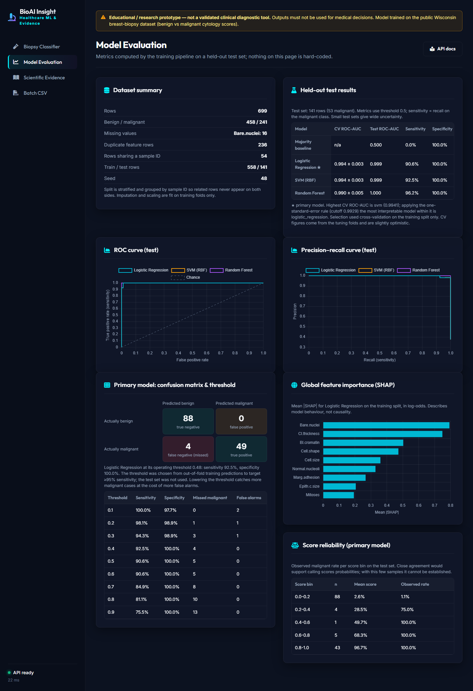
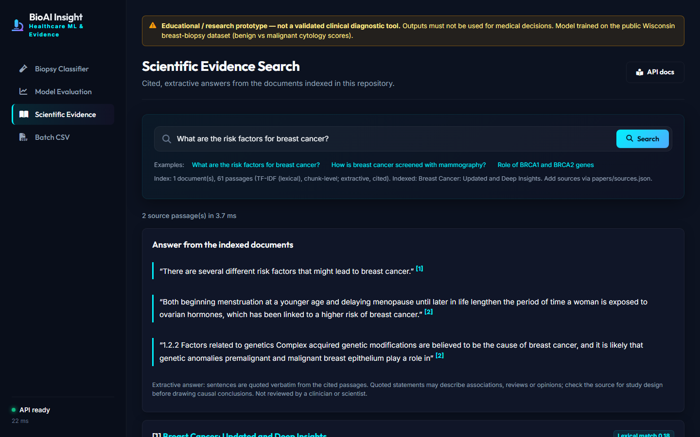
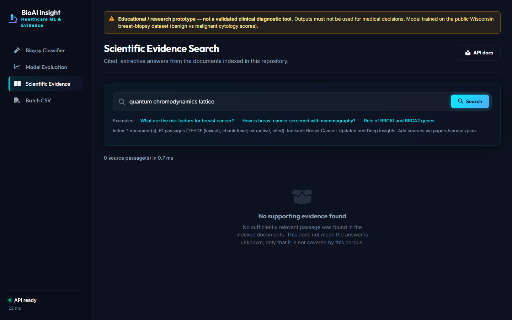
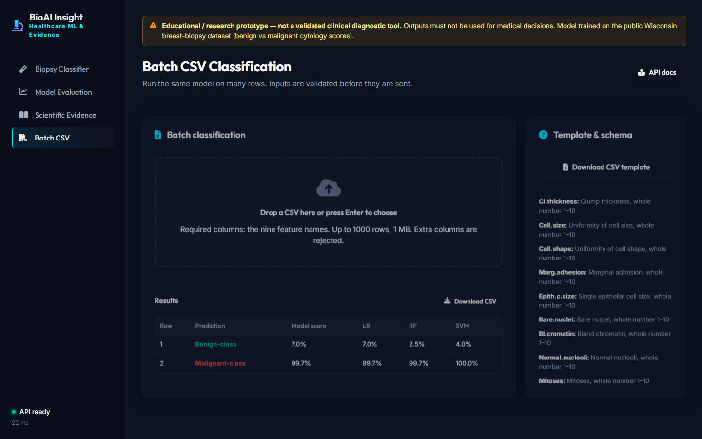
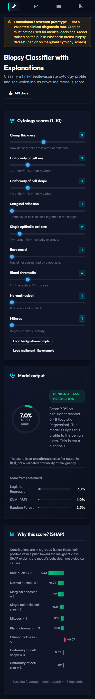

# BioAI Insight Engine

**An explainable healthcare-ML and scientific-evidence platform (educational prototype).**

> **Not a clinical tool.** This is a research/portfolio prototype. It has not been validated on any external population and must not be used for medical decisions.

Two clearly separate capabilities behind one small FastAPI service and web UI:

1. **Explainable ML** - classify fine-needle-aspirate cytology scores (Wisconsin breast-biopsy data) as benign vs malignant, with leakage-safe preprocessing, cross-validated model comparison, held-out evaluation, threshold analysis and SHAP explanations.
2. **Scientific evidence search** - ask a question and get *extractive*, cited answers (verbatim quotes with source cards) from the documents listed in `papers/sources.json`, with explicit "no evidence" abstention.

## Screenshots

All screenshots are real captures of the running app, produced by `scripts/e2e_smoke.py` (headless Chromium driving the actual UI).

### 1. Biopsy Classifier (default input, benign-class output)


### 2. Classifier with a malignant-like profile and SHAP contributions


### 3. Model Evaluation (dataset summary, test metrics, ROC/PR curves, confusion matrix, thresholds, SHAP importance)


### 4. Scientific Evidence: cited, extractive answer


### 5. Scientific Evidence: explicit "no evidence" state


### 6. Batch CSV classification (validated upload, results table)


### 7. Mobile layout (390 px wide)


Regenerate them with `python scripts/e2e_smoke.py` (needs `playwright install chromium` and trained models).

## Why this exists / what it demonstrates

Healthcare ML fails quietly when data handling, evaluation or claims are sloppy. The project is built to show the habits that prevent that: validate inputs, fit preprocessing on training data only, group related rows, compare against a baseline, report sensitivity and not just accuracy, label uncalibrated scores honestly, explain models without claiming causation, ground text in sources, test failure paths, and state what is *not* validated. See [docs/INITIAL_AUDIT.md](docs/INITIAL_AUDIT.md) for the real problems found and fixed in the first version.

It is **not** an EEG, stress, attention or neurological system, and it has no connection to any company's products.

## What is implemented (and verified)

* Data validation + quality report (schema, ranges, NaN/inf, duplicates, constant features, target values) - [`src/preprocessing.py`](src/preprocessing.py)
* Training: imputer+scaler inside sklearn Pipelines; baseline, Logistic Regression, SVM, Random Forest; grouped+stratified hold-out; grouped CV grid search on training data only; one-standard-error primary-model rule; recall-targeted threshold from out-of-fold predictions; integrity-hashed artifacts - [`src/ml_model.py`](src/ml_model.py)
* Metrics that return *undefined* (None), not 0, when undefined - [`src/metrics.py`](src/metrics.py)
* SHAP (tree + linear) with output-shape normalisation and graceful "unavailable" - [`src/explainability.py`](src/explainability.py)
* Retrieval + extractive cited answers, TF-IDF default, optional dense MiniLM - [`src/rag_engine.py`](src/rag_engine.py)
* API with typed validation, readiness check, request ids, body limits, safe errors - [`src/main.py`](src/main.py)
* UI: classifier with SHAP bars, model-evaluation dashboard (all values computed), evidence search, batch CSV; keyboard-operable tabs, responsive, strict CSP
* Test suite (pytest) + headless-browser end-to-end script; see [docs/TESTING.md](docs/TESTING.md)

## Quick start

```bash
git clone https://github.com/rejoy2004-rgb/BioAI-Insight_Engine && cd BioAI-Insight_Engine
python -m venv .venv && source .venv/bin/activate      # Windows: .venv\Scripts\activate
pip install -r requirements.txt
python -m src.ml_model                                 # train + evaluate (~1 min), writes data/models/
python -m uvicorn src.main:app --host 127.0.0.1 --port 8000
```

Open <http://127.0.0.1:8000> (API docs at `/docs`). Python 3.11 was used; other versions are untested.
If models are not built, `/ready` returns 503 and the UI says so. Docker: see [docs/DEPLOYMENT.md](docs/DEPLOYMENT.md) (**the image has not been built/tested**).

Optional dense retrieval: `pip install sentence-transformers` and `BIOAI_RETRIEVER=dense` (see [docs/RAG_EVALUATION.md](docs/RAG_EVALUATION.md)).

## Tests

```bash
pip install -r requirements-dev.txt
ruff check .
python -m pytest                      # deterministic, offline, ~30 s
python scripts/e2e_smoke.py           # needs: playwright install chromium; drives the real UI, writes screenshots
```

## Training and evaluation methodology

Full details, results and caveats: [docs/MODEL_CARD.md](docs/MODEL_CARD.md). In short:

* 699 rows -> grouped, stratified hold-out (558 train / 141 test). All tuning and model selection use cross-validation on the training part; the test set is used once for reporting.
* **Results (test set, 53 malignant cases):** all three real models reach ROC-AUC 0.999-1.000; at the default 0.5 threshold sensitivity is 0.91 (LR) / 0.93 (SVM) / 0.96 (RF) with specificity 1.00; the majority-class baseline gets accuracy 0.62 but sensitivity 0. Differences between the models are within noise at this test size, so the simplest competitive model (logistic regression) is the primary model. A PyTorch MLP experiment gave no gain (`experiments/`).
* **Scores are uncalibrated** and are shown as "model score", never as a probability of cancer or "confidence".
* These near-ceiling numbers describe an easy, small, 1990s single-source dataset - they are not evidence of clinical performance.

## Explainability methodology

SHAP `LinearExplainer` (logistic regression, units: log-odds) / `TreeExplainer` (random forest) on the preprocessed features; global importance = mean |SHAP| on the training split, precomputed at training time. The UI shows signed per-feature contributions with the feature values. SHAP explains *the model*, not biology; correlated features share credit arbitrarily.

## Evidence-search pipeline

PDF/TXT -> boilerplate + reference-list stripping -> ~130-word overlapping passages -> index -> top-k passages above a minimum score -> sentences overlapping the question are quoted verbatim with `[n]` citations -> source cards from `papers/sources.json` (title, authors, journal, year, identifier, page, link). **No LLM is used and nothing is generated.** The shipped corpus is **one** open-access paper (CC BY 4.0), so coverage is narrow by design; add sources in `papers/sources.json`.

Sample questions for a demo: *What are the risk factors for breast cancer?* · *How is breast cancer screened with mammography?* · *Role of BRCA1 and BRCA2 genes* · *(no-evidence case)* *How do lithium batteries work?*

## Suggested 3-minute demo

1. **Classifier** tab: load the benign-like and malignant-like examples; point at the score, the operating threshold, the "uncalibrated" note and the SHAP bars (signed, with units).
2. **Model Evaluation**: baseline vs models, sensitivity/specificity, confusion matrix, threshold table ("what do we trade when we lower the threshold?"), reliability bins ("why this is not a probability").
3. **Scientific Evidence**: a covered question (quotes + numbered sources), then an uncovered one (explicit no-evidence).
4. **Batch CSV**: upload the template; then a malformed file to show validation.
5. Mention the audit trail: `docs/INITIAL_AUDIT.md` -> `docs/FINAL_AUDIT.md`.

## Known limitations

* Small, old, single-source tabular dataset; no external validation; no demographic data; wide uncertainty on a 141-row test set (no confidence intervals computed).
* Dataset provenance/licence is not documented in the repo ([DATA_DICTIONARY.md](docs/DATA_DICTIONARY.md)).
* One-document evidence base; extractive answers can quote an unhelpful sentence; no reranker; dense retrieval is optional.
* No auth, rate limiting or HTTPS; Docker image and CI workflow not yet executed ([docs/SECURITY.md](docs/SECURITY.md)).

## Privacy and safety

Inputs are processed in memory and not logged or stored; no external APIs are called. Do not enter real patient data. See [docs/SECURITY.md](docs/SECURITY.md).

## Future improvements

External validation on an independent dataset; bootstrap confidence intervals; calibration study with more data; more documents plus a reranker; optional LLM synthesis constrained to retrieved quotes with citation verification; authentication and rate limiting for public hosting.

## Repository layout

```
src/            application code (config, preprocessing, metrics, ml_model, service, explainability, rag_engine, schemas, main)
static/         web UI (vendored Chart.js / Font Awesome under static/vendor)
data/           cancer.csv (+ generated data/models/, git-ignored)
papers/         sources.json + sample.pdf
tests/          pytest suite     scripts/  e2e + retrieval evaluation     experiments/  PyTorch MLP check
docs/           audit, architecture, model card, data dictionary, RAG evaluation, security, testing, deployment
```

Licensing: no `LICENSE` file is present in the received repository - add one before inviting reuse. `papers/sample.pdf` is CC BY 4.0 per its own notice; vendored libraries keep their own licences (Chart.js MIT, Font Awesome Free CC BY 4.0/OFL/MIT).
