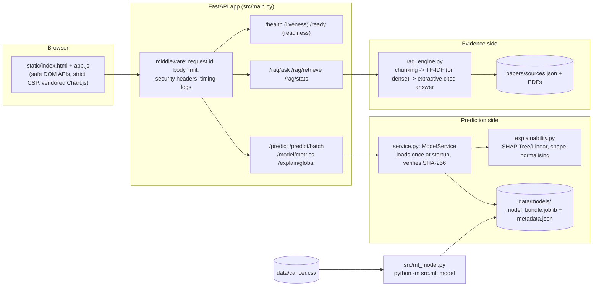

# Architecture

## Two deliberately separate capabilities

1. **Explainable ML** - tabular classifier on the Wisconsin biopsy data (`/predict`, `/model/metrics`, `/explain/global`).
2. **Scientific evidence retrieval** - cited, extractive answers over the documents in `papers/sources.json` (`/rag/*`).

They share a UI and a server, but **nothing connects them**: the retrieval side never sees model inputs or outputs, and the classifier's output is not presented as supported by the retrieved text.

## Request path (classifier)

UI slider change (debounced 250 ms, stale responses discarded) -> `POST /predict` -> Pydantic validation (nine whole numbers 1-10, extra fields rejected) -> `ModelService.predict` builds a DataFrame in canonical feature order -> each fitted Pipeline (imputer -> scaler -> model) scores it -> primary model's score is compared with the stored operating threshold -> SHAP attributions from a pre-built explainer -> JSON -> UI renders gauge, per-model scores and bars via `textContent`.

## Request path (evidence)

Question -> `POST /rag/ask` (<= 500 chars after whitespace normalisation) -> retriever returns up to k chunks above a minimum score -> `build_answer` picks sentences that overlap the question and quotes them verbatim with `[n]` markers -> source cards carry the manifest's metadata (title, authors, journal, year, identifier, page, URL). No text is generated; empty retrieval returns `status: "no_evidence"`.

## Where state lives

| State | Where | Lifetime |
|---|---|---|
| Fitted pipelines, SHAP explainers | `app.state.models` (built in `lifespan`) | process |
| TF-IDF matrix / embeddings | `app.state.rag` | process (embeddings cached on disk when `dense`) |
| Metrics, curves, importances | `data/models/metadata.json` (written by training) | until retrained |
| Request payloads | not stored; not logged | - |

## Paths and configuration

All paths resolve from `src/config.py` (`Path(__file__)`), so the server can start from any working directory. Environment variables: see `.env.example`.

## Why FastAPI was kept

It was already in use, gives typed validation + OpenAPI for free, and fits a two-endpoint-family service. No database, queue, auth layer or cloud service was added because none is needed for a single-user demonstration.
