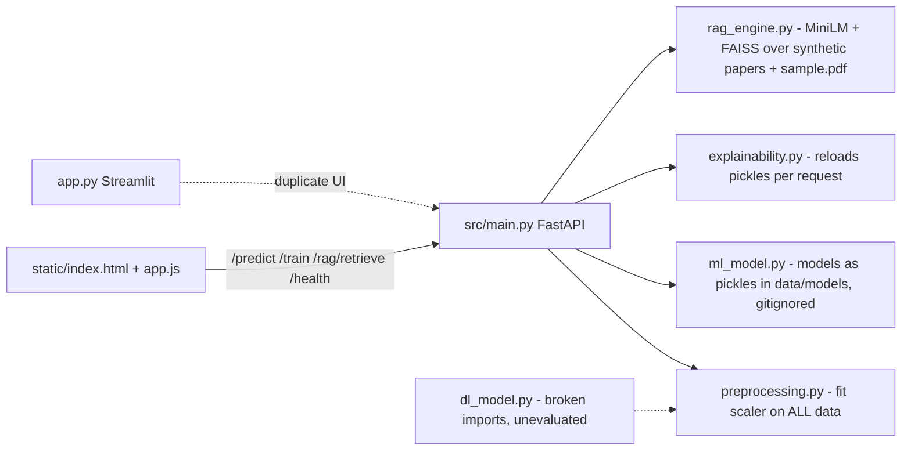

# Initial audit (baseline, before any change)

Baseline = the repository exactly as received (commit `Baseline: original repository snapshot`; all files also backed up outside the repo).
Environment: Windows 11, Python 3.11.9, scikit-learn 1.5.0, shap 0.45.0, FastAPI 0.139. No Docker available (so the original Dockerfile was **not built**).

**Verified** = I reproduced it by running code or inspecting data. **Code review** = established by reading the source only.

## Baseline test results

| Command | Result |
|---|---|
| `python test.py` | Runs `preprocess()`, then **crashes** printing an emoji (`UnicodeEncodeError`, cp1252). Side effect: **overwrote `data/scaler.pkl`**. |
| `python test_api.py` | Prints `TEST VERIFICATION FAILED:` at `/health` (empty assertion message): `data/models/` does not exist in the repo, so no model is loaded. Side effect: rebuilt `data/rag_documents.json` and wrote `data/faiss_index.bin`; downloaded an embedding model. |
| `python -m pytest` | **5 errors** - `fixture 'client' not found` (the "tests" are plain functions taking a fixture that does not exist). 0 tests passed. |
| `python src/dl_model.py` (from `src/`) | `FileNotFoundError: data/cancer.csv` (hard-coded relative path). From the repo root it fails earlier: `from preprocessing import ...` is not importable. |

## Findings

| # | Sev. | Finding | Files | Status |
|---|---|---|---|---|
| 1 | **Critical** | The "literature corpus" is **synthetic**. `generate_papers.py` randomly combines templates into 510 fake papers with **real journal names** (Nature Cancer, Lancet Oncology, JAMA Oncology...), invented authors, and invented results ("sensitivity of 97.2%", "cohort of 1,200 patients"). The app and UI present them as "500+ cancer-related research papers". | `src/generate_papers.py`, `data/papers_corpus.json`, `data/rag_documents.json`, `static/index.html` | Verified |
| 2 | **Critical** | **Train/test leakage**: `preprocess()` fits `StandardScaler` on the *entire* dataset before any split; `dl_model.py` scales then splits; the committed `data/scaler.pkl` is the full-data scaler. `ml_model.py` fits correctly on train but writes to the same path, so the artifact depends on which script ran last. | `src/preprocessing.py`, `src/dl_model.py`, `src/ml_model.py`, `data/scaler.pkl` | Verified (file content changed when `test.py` ran) |
| 3 | **High** | Misleading clinical framing. The data are *cytology scores of an aspirated breast lump* labelled benign/malignant, but the app says "Cancer risk", "High/Low Cancer Risk", "Confidence", "Calibrated confidence", "Healthy profile detected... Standard screening advised". Scores are uncalibrated classifier outputs. | `src/main.py`, `static/app.js`, `app.py` | Verified |
| 4 | **High** | Splits ignore data structure: no stratification; 54 rows share a sample `Id` with another row and 236 rows have duplicate feature vectors, so related rows can land on both sides of the split. 16 rows with a missing `Bare.nuclei` are **silently dropped** (`dropna`). | `src/preprocessing.py`, `src/ml_model.py` | Verified (data inspected) |
| 5 | **High** | Weak/misleading evaluation: only accuracy + ROC-AUC shown; precision/recall/F1 are *weighted averages* (hide minority-class behaviour); no CV, no baseline, no threshold analysis, hyper-parameters fixed by hand; no confusion matrix / PR curve in the UI. | `src/ml_model.py` | Code review |
| 6 | **High** | Readiness: `/health` always returns `"healthy"` even when no model or scaler is loaded; `/predict` lazily retries loading on each request. No model artifacts ship with the repo and nothing tells the user to train. | `src/main.py` | Verified |
| 7 | **High** | Silent failures: a model that throws in `/predict/batch` gets probability `0.0` and the request still succeeds; `/predict` swallows per-model and SHAP errors with `print`. | `src/main.py` | Code review |
| 8 | **High** | Unauthenticated `POST /train` retrains and replaces global models for anyone who can reach the server (DoS / integrity). | `src/main.py` | Code review |
| 9 | **High** | Hard-coded relative paths (`"data/..."`, `"static"`) - app only works when started from the repo root. | all `src/*.py` | Verified (dl_model) |
| 10 | **Medium** | SHAP: unpickles the model from disk **on every request**; linear explainer re-reads the CSV and re-fits a background each call; global importance recomputed per request; SVM silently returns `None`; the UI labels the logistic-regression base value (a log-odds number) as "Prior Probability %". | `src/explainability.py`, `static/app.js` | Code review |
| 11 | **Medium** | RAG: dense MiniLM + FAISS **L2**, then `1/(1+dist)` shown as "Match %" (not a meaningful similarity); **no minimum score**, so nonsense queries still return k "relevant" papers; PDF chunks are fixed 800-char slices that include headers and the reference list, with author/journal **hard-coded** in code; there is no answer generation, so "RAG" is retrieval only. | `src/rag_engine.py` | Verified (index rebuilt during baseline test) |
| 12 | **Medium** | Dependencies: `requirements.txt` omits `fastapi`, `uvicorn`, `shap`, `pydantic` (the Dockerfile `pip install`s them separately, unpinned); includes `streamlit`, `torch` (several GB) that the API does not need; nothing pinned or bounded. Container runs as root, has no `.dockerignore`, healthcheck, or non-root user. | `requirements.txt`, `Dockerfile` | Code review (Docker not available) |
| 13 | **Medium** | Frontend inserts API data with `innerHTML` (titles, authors, error messages, regex-highlighted abstracts) - an XSS pattern; Chart.js loaded from a CDN **without a version or SRI** (`chart.js` = latest); no CSP; no request body limit; no security headers. | `static/app.js`, `static/index.html`, `src/main.py` | Code review |
| 14 | **Medium** | Frontend UX: prediction errors only `console.error`; batch errors use `alert()`; nav items are links with `href="#"` (no tab semantics); drop zone not keyboard-operable; status badge text hard-coded "API Online"; sidebar stays 80 px wide on phones; no loading/empty states for the classifier. | `static/*` | Code review |
| 15 | **Low** | Files opened without `encoding=` (breaks on Windows cp1252); Pydantic v2 warning (`allow_population_by_field_name`); FastAPI `on_event` is deprecated. | `src/*.py` | Verified (warnings in pytest output) |
| 16 | **Low** | Two UIs (Streamlit `app.py` and `static/`) with divergent wording and behaviour; the Streamlit offline fallback relied on pickled models and the leaky scaler. | `app.py` | Code review |
| 17 | **Low** | Provenance: no documentation of where `cancer.csv` came from; 1 MB generated cache (`rag_documents.json`) and a binary pickle committed. `sample.pdf` states CC BY 4.0 in its own text. | `data/`, `papers/` | Verified |
| 18 | Info | No secrets found in the working tree or in git history (pattern scan for common key formats; only one commit exists in the received snapshot, so earlier history of the upstream GitHub repo was **not** inspected). | - | Verified (limited) |

## Architecture as found

Entry point actually used: `uvicorn src.main:app` (Dockerfile). `app.py` is an alternative Streamlit client. Frontend/back-end endpoints matched by path, but several response fields were misleading (see #3, #10).
